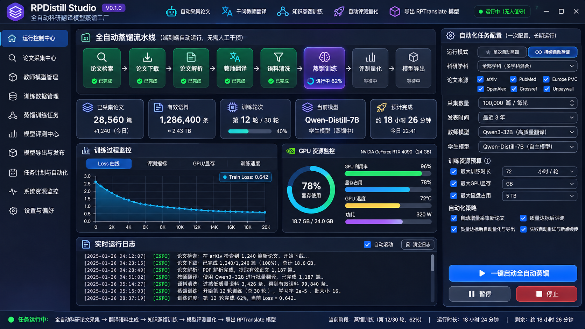

# RPDistill Studio

独立科研翻译模型训练与知识蒸馏工作台（E 线路）。

RPDistill 负责教师模型、语料、训练、评测和模型导出。RPTranslate 保持独立 Rust 推理，不依赖训练环境。

## 当前状态
E3.1：E2.3 标准 CI（含真实微型 CPU 推理）与联网回归 10/10 已通过；新增 Europe PMC 论文检索、元数据预筛及去重（待 CI）。真实千问质量/GPU 验收待本机。

## 快速开始
```sh
python -m pip install -e .
python -m rpdistill
python -m unittest discover -s tests -v
```

研发计划：[ROADMAP](docs/ROADMAP.md) · [ARCHITECTURE](docs/ARCHITECTURE.md) · [HANDOFF](docs/HANDOFF.md)

公开仓库不提交私有论文、模型权重、API 密钥或训练数据。使用教师模型前须核查模型许可证与训练数据使用权限。

## 功能与进度
- [完整功能清单（FEATURES.md）](docs/FEATURES.md)
- [研发进度与 CI 验收台账（PROGRESS.md）](docs/PROGRESS.md)

## 内置在线下载（规划中的必选功能）
教师模型及合法公开训练数据集支持软件内搜索、一键下载、断点续传、完整性校验与自动入库；正常联网使用无需手动下载文件。E2.1 Hugging Face 基础搜索/下载/注册 CPU CI 已通过；E2.2a 队列及文件级进度 CPU CI 已通过；E2.2b1 ModelScope 基础适配待 CI，实时网络字节与数据集仍待开发。

## 科研论文在线采集（必选，E3.1 开发中）
直接在软件内按关键词、学科、日期搜索论文，批量下载许可允许的全文并自动解析、分段入库，由教师模型生成高质量双语训练语料。不需要手动逐篇下载 PDF。E3 实现核心、E11 集成 GUI。

## 全自动蒸馏（核心目标，待实现）
一次设置，自动搜索论文、下载合法全文、教师翻译、清洗生成训练集、触发学生蒸馏、评测量化及导出。[自动化规范](docs/AUTOMATION.md)。支持单次和预先授权的持续增量运行。

## GUI 设计参考
[全自动蒸馏控制中心设计稿与 E11 界面要求](docs/assets/README.md)（高清设计稿，非运行截图）。




### E1.2 本地基础功能
```sh
python -m rpdistill devices
python -m rpdistill create --teacher Qwen-candidate --student RPTranslate
python -m rpdistill list
python -m rpdistill show <task-id>
python -m rpdistill events <task-id>
``
默认数据库为 ~/.rpdistill/tasks.sqlite3；可在子命令前使用 --db 指定路径。创建实验仅保存配置并排队，不会下载模型或开始训练。NVIDIA 探测不等于 CUDA 训练验收。

### E2.1 教师模型管理
```sh
python -m pip install -e ".[hub]"
python -m rpdistill model-search Qwen --limit 10
python -m rpdistill model-list
``
选择搜索结果的实际 model_id 和完整 revision，核查许可证允许预定用途后，使用 `python -m rpdistill model-download MODEL_ID --revision FULL_COMMIT_SHA --reviewed-license LICENSE_ID --max-bytes BYTES`。软件下载、校验并登记，不需手动下载权重。只支持公开非 gated SafeTensors 模型；不会加载或执行模型代码。SDK 管理缓存，本阶段尚无应用级下载队列/暂停控制及实际在线验收。

### E2.2a 下载队列
将 model-download 替换为 download-enqueue（参数相同），再执行 `python -m rpdistill download-run` 处理一个排队任务。另一终端可执行 download-list、download-show ID、download-pause ID、download-cancel ID。暂停/取消在文件间检查，不强制中断 SDK 正在传输的单个文件；download-resume ID 重新排队，SDK 缓存复用，实际字节断点能力待联网验证。download-recover ID --worker-stopped 仅在确认原 worker 已退出时使用。rate/eta 是已校验文件字节的处理速率及估算，包含缓存命中，不是网络带宽。单次 run 仅执行一个任务，持续调度待后续。

### E2.2b1 ModelScope
```sh
python -m pip install -e ".[modelscope]"
python -m rpdistill model-search Qwen --source modelscope
python -m rpdistill model-revisions Qwen/Qwen3-0.6B
python -m rpdistill model-list --source modelscope
``
用实际完整 commit SHA、已核查的许可证和字节预算执行 model-download 或 download-enqueue，加 --source modelscope。只接收明确公开且每个选中文件具备上游 SHA-256 的模型；不能确认时拒绝下载，不自动降级到浮动分支。ModelScope 记录与 Hugging Face 隔离。当前模拟 SDK CI；实际在线响应、SDK 版本及网络速度需 E2.2b2 验证。仍使用文件级进度及 SDK 缓存，不是实时网络带宽。

### E2.2b2 下载监控与联网验收
Hugging Face 队列默认采用公开固定 revision HTTPS 逐块传输，network_bytes 为本次实际读取的响应体字节（不含缓存或恢复前的字节），network_rate 为最近更新窗口速率；done_bytes 仍为已校验文件字节。支持块间暂停和有上游 SHA-256 的部分文件 Range 恢复，服务器返回 200 时重新下载，不拼接错误范围。无上游哈希的部分文件重新下载。SDK 直接下载 CLI 与 ModelScope 暂保留文件级控制；不并行操作相同缓存目录。标准 CI 增加 SDK 安装/接口检查，独立 Public Hub live smoke 只下载 MIT GPT-2 的小 config（最多 64 KiB）及 ModelScope 查询，不下载权重。真实外网状态独立记录。

### E2.3 本地教师翻译
安装适合本机 CPU/CUDA 的 PyTorch 后，`python -m pip install -e ".[inference]"`。先使用下载中心注册已核查许可的指令模型（需要 chat template、SafeTensors 和受支持的 causal 架构）。准备 UTF-8 JSON 字符串数组，例如 `["The sample was heated to 300 K."]`，运行 `python -m rpdistill teacher-translate MODEL_ID --revision FULL_SHA --input source.json --source-language English --target-language Chinese --device cpu`。GPU 使用显式 --device cuda:0 及适配 dtype。模型仅本地读取、重新核验清单、禁用远程自定义代码；不截断超长输入。输出为候选翻译及来源/版本，截断或空输出进入待审核，仍需 E3 清洗和 E7 评测。CI 临时创建随机微型模型验证真实 CPU 加载与生成，不测试翻译能力。

### E3.1 论文检索
```sh
python -m rpdistill paper-search --keyword malaria --subject vaccine --start-date 2024-01-01 --end-date 2024-12-31 --language eng --limit 20
python -m rpdistill paper-list --limit 20
``
Europe PMC 官方 API（生命科学/医学优先），多个 keyword 取 OR，subject 是额外关键词而非正式学科分类。日期采用来源 FIRST_PDATE，语言由来源检索字段筛选；limit 限制检查记录数，并非新增论文保证。默认仅检索 OA；CC BY/CC0 且有 PMCID 的元数据仅进入待全文许可复核，其他阻断；不下载全文、不授权训练、不保存摘要。下一步全文许可验证及合法下载，之后扩展其他学科来源。官方文档：https://europepmc.org/RestfulWebService 与 https://europepmc.org/downloads/openaccess 。

E3.1 联网测试首次返回 HTTP 503，已加入有限重试及 Retry-After 支持，真实联网验收仍待复验。

E3.1 备用来源：paper-search --provider auto（默认）在 Europe PMC 首个请求发生可重试网络失败且重试耗尽后改用 NCBI PMC ESearch/ESummary；--provider europe-pmc / ncbi-pmc 可单独选择。返回 provider、fallback_from 和 fallback_reason，不隐藏原始故障。已部分完成的检索不自动重新消耗预算。NCBI 默认使用 OA 与 CC BY/CC0 查询筛选，确切许可仍须全文复核；不下载全文。官方文档：https://pmc.ncbi.nlm.nih.gov/about/userguide/ 与 https://pmc.ncbi.nlm.nih.gov/tools/get-metadata/ 。原 Europe PMC 真实联网测试保留。

E3.1 最新代码验收：标准 CI 8/8 通过，NCBI PMC 真实检索 3 条并成功入库；Europe PMC 仍返回 HTTP 503，已请求仅重跑失败任务。E3.2 尚未开始，具体记录见 PROGRESS.md。

Europe PMC 日期检索按 FIRST_PDATE 筛选，使用官方 P_PDATE_D desc 排序（打印出版日期），不保证按首次发表日期全局严格排序。修复版待 CI 及真实联网复验。
