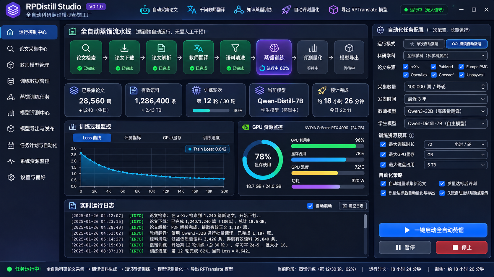

# RPDistill Studio GUI 设计参考

正式采用最新深色中文全自动蒸馏控制中心设计稿（PNG，1672 × 941，原始画质）。
目标文件：`docs/assets/rpdistill-auto-distill-dashboard.png`。
原始文件记录的 SHA-256（尚未重新核验远程文件字节）：`8d0e37e1f408f11a955c9fdd9c9b17cd79850623d60b159754c14b458322b26b`。
状态：设计参考已确定；PNG 文件已上传并核实仓库路径及大小（2,007,512 字节）；Git blob SHA：`598f5904f8e501252ec56837d3cfaffa27fa2c90`。本页不代表 GUI 已实现。

E11 GUI 开发须参考该图的中文深色布局：左侧功能导航，中间自动化阶段流水线、指标卡片、Loss 曲线、GPU 监控及实时日志，右侧任务配置、单次/持续模式、资源预算、启动/暂停/停止。页面数值、模型名称和硬件均是设计示例，实际实现以真实后端及配置为准。
